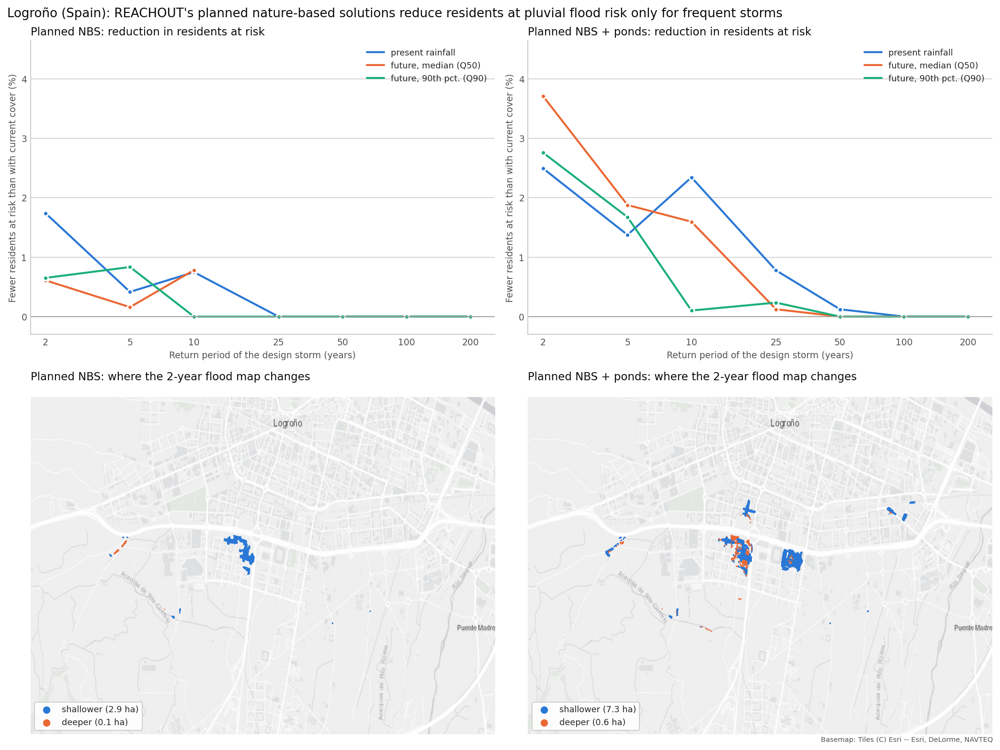

# logrono-planned-nbs-flood-risk

[](https://github.com/annefou/logrono-planned-nbs-flood-risk/actions/workflows/ci.yml)
[](https://annefou.github.io/logrono-planned-nbs-flood-risk/)
[](https://github.com/annefou/logrono-planned-nbs-flood-risk/pkgs/container/logrono-planned-nbs-flood-risk)
[](https://opensource.org/licenses/MIT)
[]({{ZENODO_DOI}})
[](docs/fair4rs-checklist.md)
[](https://forrt.org/)
[](nanopubs/PUBLISHED.md)
[](ro-crate-metadata.json)
[](https://archive.softwareheritage.org/browse/origin/?origin_url=https://github.com/annefou/logrono-planned-nbs-flood-risk)

> **Do REACHOUT's planned nature-based solutions reduce building-level pluvial flood risk in Logroño (Spain)?** — one FORRT nanopublication chain.
> Built on the [Logroño flood-adaptation scenarios analysis v0.1.0](https://doi.org/10.5281/zenodo.23298913) ([repository](https://github.com/annefou/logrono-flood-adaptation-scenarios)) and the [REACHOUT flood maps](https://doi.org/10.5281/zenodo.14035876). Method: [Vogelbacher et al. (2026), NHESS](https://doi.org/10.5194/nhess-26-2765-2026).

**Finding (AIDA):** *The nature-based solutions of REACHOUT's planned scenario for Logroño reduce the number of residents in buildings at pluvial flood risk by less than 4 %, with no reduction during the 100- and 200-year storms.* Without the extra ponds the reduction stops after the 10-year storm, with them after the 50-year storm; it is never an increase. The measures are those of REACHOUT's planned scenario (*"4 bioswales/ponds (= 29,850 m3) and a green corridor (5.3 km x 5 m) in the southern part of the city"*, plus *"small ponds/rain gardens (depth 0.5 m, 13,500 m3)"*), modelled by REACHOUT as infiltration and terrain changes without sewers — not the city's plans as they may be built.



## Pipeline

| Step | Notebook | What it does |
|---|---|---|
| 1 | [`01_data_download`](notebooks/01_data_download.py) | Downloads the analysis release and the REACHOUT archive (both MD5-checked); `RERUN_ANALYSIS = True` re-runs the analysis itself |
| 2 | [`02_data_clean`](notebooks/02_data_clean.py) | Residents at risk, changed hazards, flood-map changes and impact places for the current cover and both planned versions |
| 3 | [`03_analysis`](notebooks/03_analysis.py) | The finding in every case (`results/claim_test.json`), which buildings and cells change, recorded impact places |
| 4 | [`04_figures`](notebooks/04_figures.py) | `figures/main_result.png`: the reduction by return period and where the 2-year flood map changes |

```bash
git clone https://github.com/annefou/logrono-planned-nbs-flood-risk.git
cd logrono-planned-nbs-flood-risk
pixi install
pixi run snakemake --cores 1
```

## The chain

Drafts in [`nanopubs/drafts/`](nanopubs/drafts/), the wizard hand-off in [`nanopubs/chain-draft.json`](nanopubs/chain-draft.json), published URIs in [`nanopubs/PUBLISHED.md`](nanopubs/PUBLISHED.md). Related: the Logroño replication's chain (<https://w3id.org/sciencelive/np/RAoFYugT7OVk5eoHuxKCO9HeqA08jMfSn7TeUxwZcbezE>) and the study area (<https://w3id.org/sciencelive/np/RAzds1z9t2ac7XFvx_Hsv18__p5nUTNA0NHIsskSyLVPQ>). Sibling chains: [future rainfall](https://github.com/annefou/logrono-future-rainfall-flood-risk), [greening and social vulnerability](https://github.com/annefou/logrono-greening-flood-risk-vulnerability).

## Data and credits

Flood maps: Andrea Staccione, Jeremy S. Pal (REACHOUT, CC BY 4.0). Buildings: Dirección General del Catastro. Census: INE. Basemap: Esri.

## Citation

Cite via [`CITATION.cff`](CITATION.cff) → DOI [{{ZENODO_DOI}}]({{ZENODO_DOI}}), with the analysis [10.5281/zenodo.23298913](https://doi.org/10.5281/zenodo.23298913) and the method paper [10.5194/nhess-26-2765-2026](https://doi.org/10.5194/nhess-26-2765-2026).

Created from [`sciencelivehub/forrt-replication-template`](https://github.com/sciencelivehub/forrt-replication-template); see [`CLAUDE.md`](CLAUDE.md).
